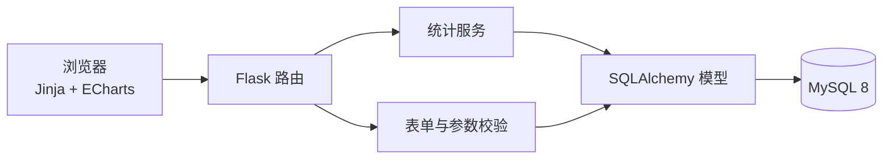
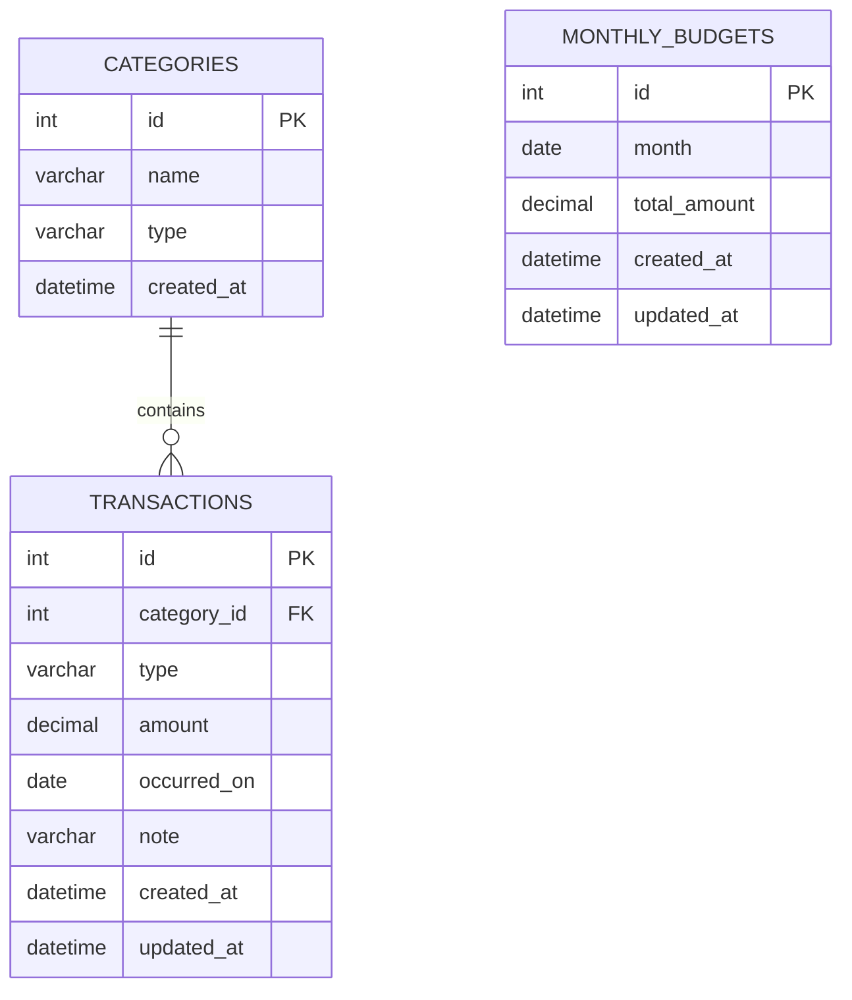

# 个人记账本设计说明

## 1. 项目目标

本项目是单用户个人记账 Web 应用，使用 Flask、MySQL、SQLAlchemy 和 ECharts。系统完成交易 CRUD、月份/类型/分类组合筛选、三类图表、月度预算及 80% 提醒。

## 2. 系统架构



职责边界：

- `app/routes/`：请求解析、页面响应、表单校验和 JSON 接口。
- `app/services/periods.py`：月份解析、月首/下月月首和月份序列。
- `app/services/statistics.py`：分类占比、月度收支、每日支出和预算已用金额聚合。
- `app/models.py`：分类、交易和预算模型及约束。
- `app/templates/`：页面结构；不在前端重复计算业务统计。
- `app/static/js/dashboard.js`：请求三个统计接口并渲染 ECharts。

## 3. ER 图



`monthly_budgets` 与交易不建立外键，预算按月份独立保存。

## 4. 表结构

| 表 | 核心字段 | 关键约束 |
| --- | --- | --- |
| `categories` | `id`、`name`、`type` | `(type,name)` 唯一；类型仅收入/支出 |
| `transactions` | `category_id`、`type`、`amount`、`occurred_on`、`note` | 金额非负；日期索引；类型与分类组合索引 |
| `monthly_budgets` | `month`、`total_amount` | 月份唯一；预算金额非负 |

金额使用 `DECIMAL(12,2)`，业务层使用 `Decimal`，避免二进制浮点误差。交易日期使用 `DATE`。

## 5. 聚合 SQL

### 5.1 当月支出分类占比

```sql
SELECT c.id, c.name, SUM(t.amount) AS total
FROM categories AS c
JOIN transactions AS t ON t.category_id = c.id
WHERE t.type = 'expense'
  AND t.occurred_on >= :month_start
  AND t.occurred_on < :next_month_start
  AND (:category_id IS NULL OR t.category_id = :category_id)
GROUP BY c.id, c.name
ORDER BY total DESC, c.name;
```

结果用于饼图。`total` 是所有切片金额之和。

### 5.2 近 6 个月收支

```sql
SELECT YEAR(t.occurred_on) AS year,
       MONTH(t.occurred_on) AS month,
       t.type,
       SUM(t.amount) AS total
FROM transactions AS t
WHERE t.occurred_on >= :first_month_start
  AND t.occurred_on < :month_after_end
  AND (:category_id IS NULL OR t.category_id = :category_id)
GROUP BY YEAR(t.occurred_on), MONTH(t.occurred_on), t.type;
```

服务层先构造连续 6 个月列表，再把 SQL 结果映射到月份；缺失月份补 0。

### 5.3 每日支出

```sql
SELECT t.occurred_on, SUM(t.amount) AS total
FROM transactions AS t
WHERE t.type = 'expense'
  AND t.occurred_on >= :month_start
  AND t.occurred_on < :next_month_start
  AND (:category_id IS NULL OR t.category_id = :category_id)
GROUP BY t.occurred_on;
```

服务层根据 `calendar.monthrange()` 生成完整日期序列，无记录日期补 0，因此能处理 28、29、30、31 天月份。

### 5.4 预算已用金额

```sql
SELECT SUM(t.amount)
FROM transactions AS t
WHERE t.type = 'expense'
  AND t.occurred_on >= :month_start
  AND t.occurred_on < :next_month_start;
```

预算警告使用未四舍五入的原始比例判断，只有真实支出比例达到 80% 才提醒。

## 6. 图表联动

```text
月份 + 分类
    |
    +--> /api/statistics/category --> 分类占比饼图
    +--> /api/statistics/months   --> 近 6 个月并列柱状图
    +--> /api/statistics/daily    --> 每日支出折线图
    +--> /api/budget              --> 预算进度与提醒
```

三张图全部在服务端聚合。前端只在所有请求成功后统一重绘，避免部分图表显示新旧混合数据。

## 7. 校验与安全

- 金额只接受非负的整数或最多两位小数。
- 日期和月份使用严格解析，月份查询采用左闭右开区间。
- 分类必须存在，且分类类型必须与交易类型一致。
- 写操作启用 CSRF；删除只接受 POST 并弹出二次确认。
- SQL 通过 SQLAlchemy 参数绑定执行。
- 数据库密码由 `.env` 或 `DATABASE_URL` 提供，不提交真实配置。
- 错误页不暴露数据库异常细节。

## 8. 种子数据与验收

`database/seed.sql` 和 `flask seed-demo` 均生成 60 条交易，覆盖最近 5 个月，并故意留出一个无数据月份。当前自动化测试覆盖：

- CRUD、CSRF、分页和组合筛选。
- 负数、超过两位小数、非法日期和分类类型不一致。
- 月末/月初、跨年月份、无数据月份和闰年 2 月。
- 三类聚合结果和分类筛选。
- 预算 80% 临界值。
- 自定义分类和重复分类。

执行：

```powershell
.\.venv\Scripts\python.exe -m pytest -q
```

当前结果：`25 passed`。
